<div align="center">

# photo-restore

*An agent skill to restore, repair and colorize old family photographs*

[](https://skills.sh)
[](https://www.python.org)
[](https://docs.astral.sh/uv/)
[](LICENSE)

[Examples](#examples) • [Variants](#what-you-get) • [Installation](#installation) • [Usage](#usage) • [Models and hardware](#models-and-hardware)

</div>

An agent skill that brings old photographs back: it fills holes and peeled emulsion, removes stains and scratches, sharpens faces, upscales, removes worn borders and oval mounts, and optionally colorizes. Your coding agent (Claude Code, Codex, GitHub Copilot, OpenCode and others) looks at each photo first, picks the settings, runs the pipeline, and compares every result with the original before recommending one. The pipeline is a plain Python script, so you can also run it without an agent.

It runs **locally** on your GPU through [ComfyUI](https://github.com/Comfy-Org/ComfyUI), or **in the cloud** through [fal.ai](https://fal.ai). Your originals are never modified.

## Examples

The three photos in [examples/](examples) are real family photos from the early 1900s, published with permission. Each one has a different kind of damage.

**Heavy emulsion loss, worn and missing corners**

| Original | Repaired | Full frame | Generative (Turbo) | Colorized |
|:---:|:---:|:---:|:---:|:---:|
| 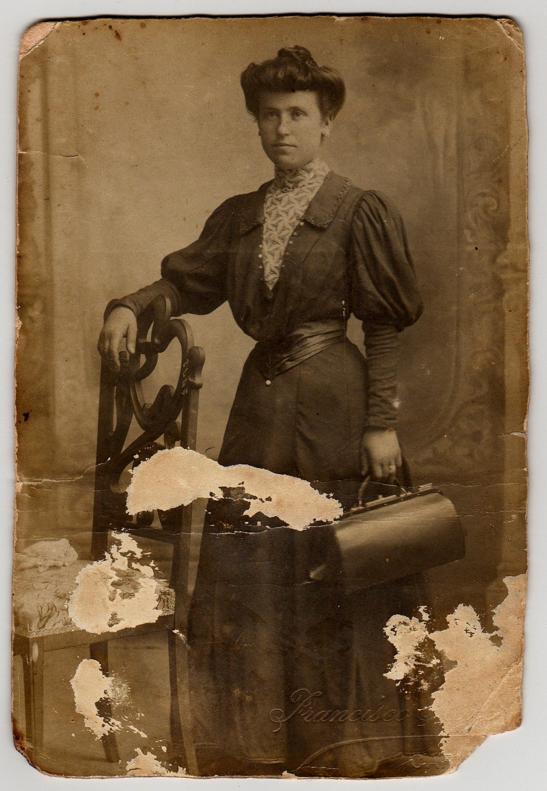 | 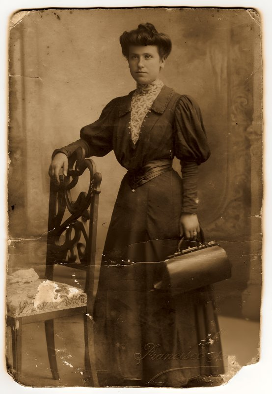 | 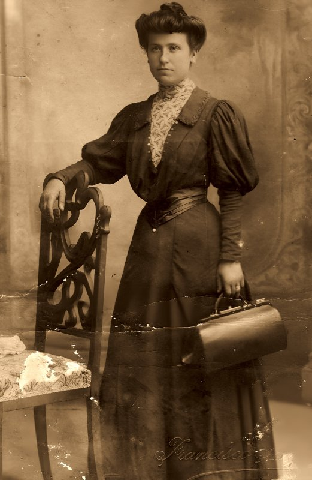 | 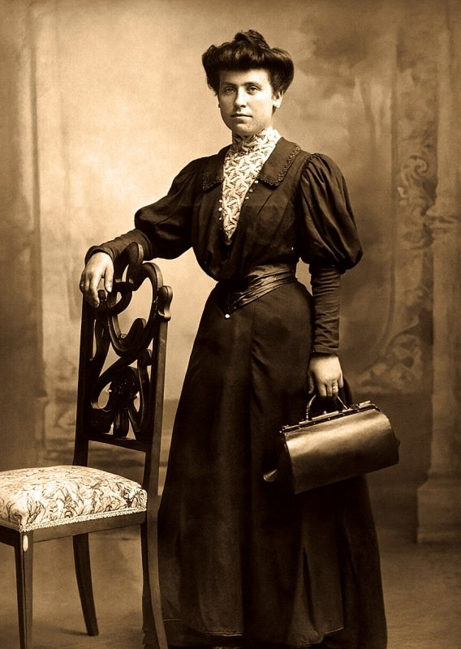 | 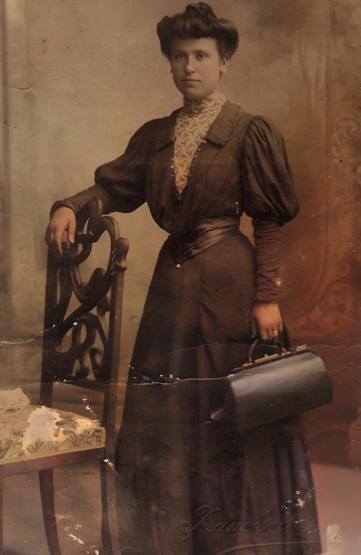 |

**Tear, foxing, faded contrast**

| Original | Repaired | Generative | Generative (Turbo) | Colorized |
|:---:|:---:|:---:|:---:|:---:|
| 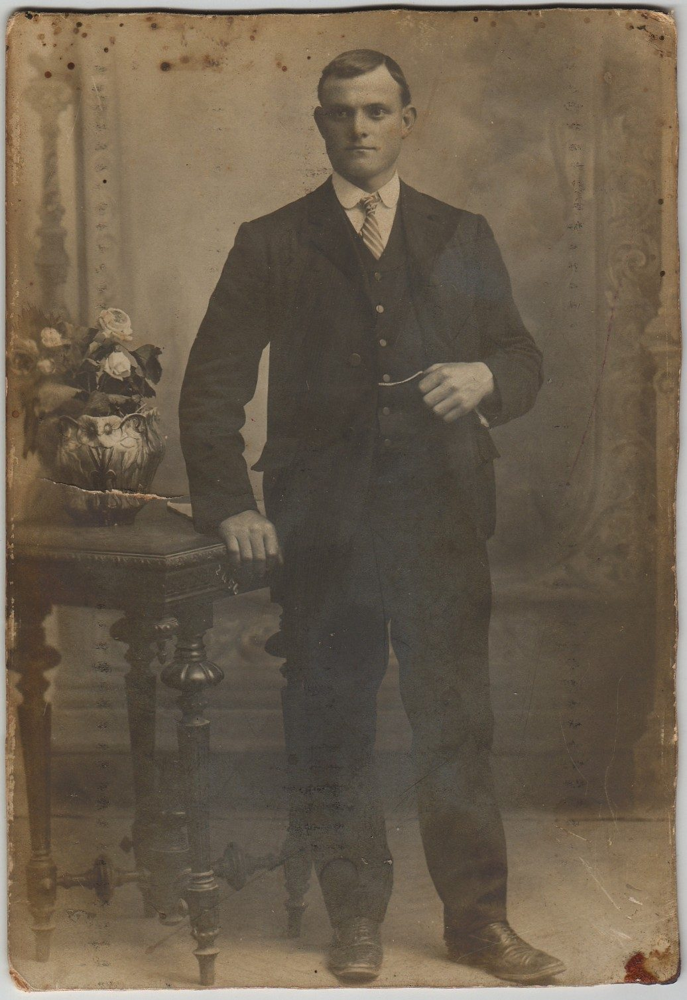 | 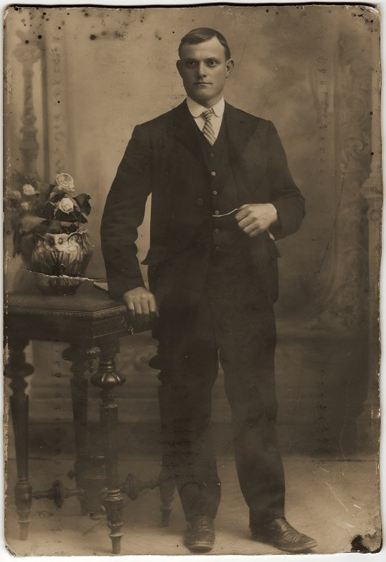 | 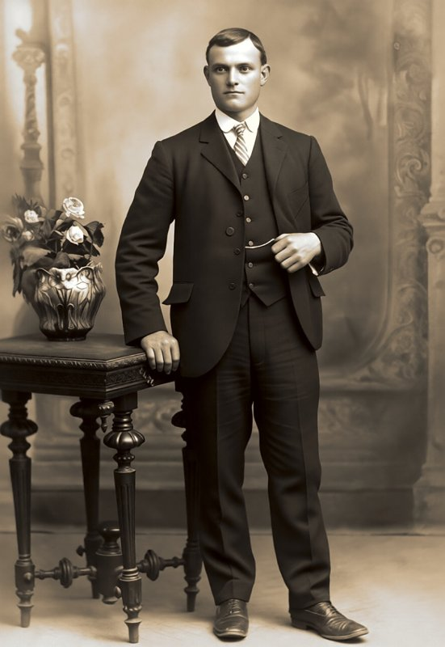 | 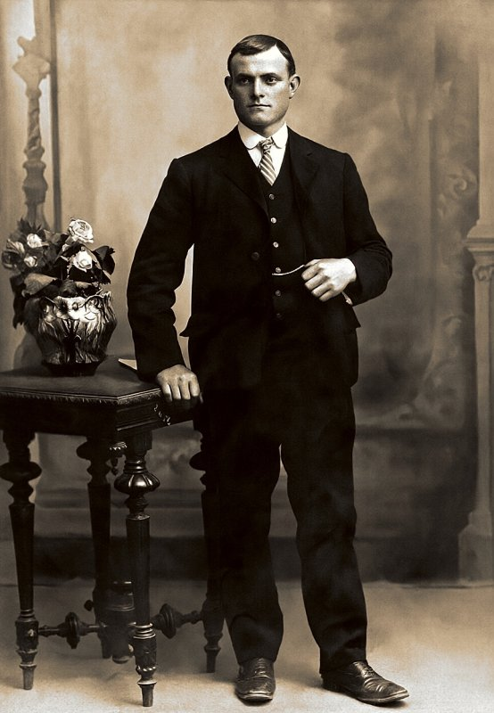 | 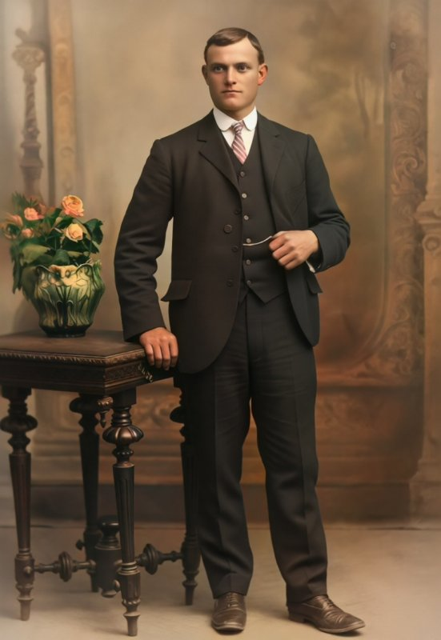 |

**Oval vignette on a card mount, turned into a rectangular portrait**

| Original | Full frame | Full frame (Turbo) | Full frame, colorized |
|:---:|:---:|:---:|:---:|
| 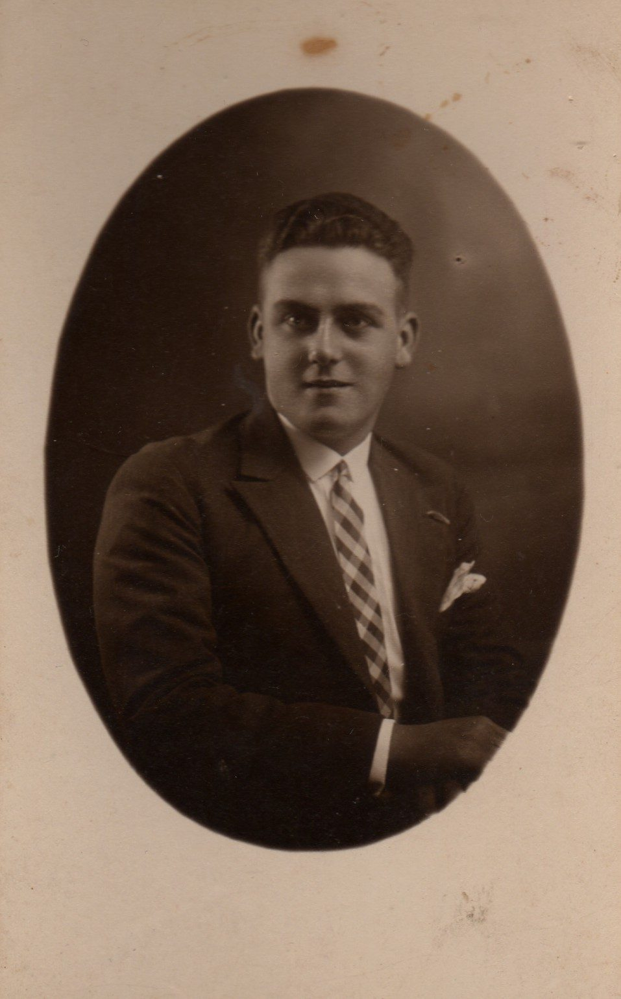 | 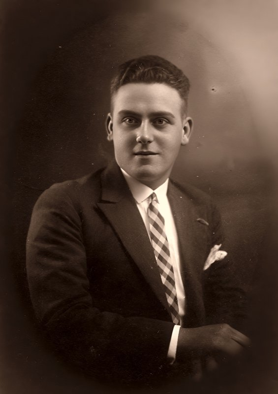 | 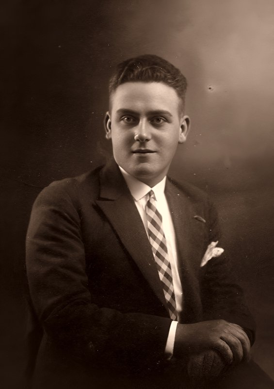 | 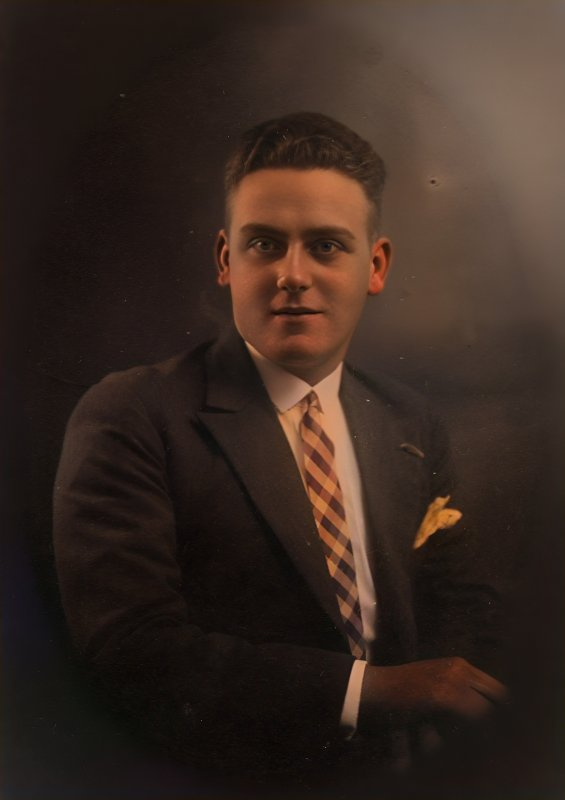 |

Every run also writes a comparison page (`restored/index.html`) with a before/after slider for each variant.

## What you get

Each photo gets one folder with the original, every stage, and a finished `*-final.jpg` per variant:

| Variant | Option | What it does |
|---|---|---|
| **Conservative** | always | x2 upscale and face restoration ([Real-ESRGAN](https://github.com/xinntao/Real-ESRGAN), [CodeFormer](https://github.com/sczhou/CodeFormer)). Faithful, invents nothing, doesn't remove damage. |
| **Generative** | `--generative` | The whole photo restored by an image-editing model. Cleanest result, but it redraws everything, faces included, so always compare. |
| **Repaired** | `--repair` | Finds the damage (holes, peeled emulsion, stains) and regenerates only those areas. Everything else, faces included, stays the original pixels. |
| **Full frame** | `--full-frame` | A clean rectangular picture: worn rims cropped, missing corners filled, oval mounts and vignettes extended into a full portrait. |
| **Colorized** | `--colorize` | Natural colours with [DDColor](https://github.com/piddnad/DDColor), one per restored variant (generative or conservative, repaired, full frame). |

Black-and-white and sepia variants keep the print's own tint: AI models invent colour (blue eyes, pink skin) even on monochrome photos, so the pipeline keeps only their lightness and rebuilds the tint from the original.

## Installation

Install the skill for your agent with [skills](https://skills.sh):

```bash
npx skills add https://github.com/elboletaire/ai-photo-restore --skill restore-photos
```

It works with any agent that supports [Agent Skills](https://agentskills.io) (Claude Code, Codex, GitHub Copilot, OpenCode, Amp, ...). In Claude Code you can also install it as a plugin:

```
/plugin marketplace add elboletaire/ai-photo-restore
/plugin install photo-restore@photo-restore
```

The only hard requirement is [uv](https://docs.astral.sh/uv/getting-started/installation/), which runs the pipeline script and installs its Python dependencies. It works on Linux, macOS, Windows and WSL. Your agent needs to be able to run shell commands; to review the results it also has to be able to look at images. Then pick a backend.

### Local (ComfyUI)

Ask your agent to *"set up the local photo restoration backend"*. It follows [setup-local.md](skills/restore-photos/references/setup-local.md): installs ComfyUI with [comfy-cli](https://github.com/Comfy-Org/comfy-cli) if needed (or reuses yours: portable, Desktop or a git checkout), adds two custom nodes and downloads the models.

- All variants: an NVIDIA GPU with 16 GB of VRAM and 32 GB of RAM is comfortable; about 32 GB of disk.
- Conservative and colorized only: about 1.5 GB of models, runs on most GPUs and on Apple Silicon.
- `--repair` and `--full-frame` are local only.

> [!TIP]
> ComfyUI can run on another machine: set `COMFY_URL=http://<host>:8188` and use a laptop with the GPU of a desktop. ComfyUI has no authentication, so keep it on your local network.

### Cloud (fal.ai)

No GPU needed: roughly $0.005 per photo for the conservative variant and $0.04 with the generative one. Create a key at <https://fal.ai/dashboard/keys> and export it as `FAL_KEY` ([setup-cloud.md](skills/restore-photos/references/setup-cloud.md)).

> [!WARNING]
> With the fal.ai backend your photos are uploaded to fal.ai. Use the local backend if they must stay on your machine.

## Usage

Just ask your agent:

> Restore the photos in `~/Pictures/grandparents`, they're quite damaged. Remove the borders and colorize the wedding one too.

The agent checks the backend, looks at each photo, runs the right variants, reviews the results (and retries bad fills on its own), then points you to the comparison page with a recommendation per photo.

Or run the script yourself:

```bash
# check the backend
uv run skills/restore-photos/scripts/restore.py doctor --backend local

# damaged photos: repair only the damage, plus a generative and a colorized variant
uv run skills/restore-photos/scripts/restore.py run ~/Pictures/old --repair --generative --colorize --out restored

# a portrait in an oval mount: three fills to choose from, then pick one with --frame-seed
uv run skills/restore-photos/scripts/restore.py run portrait.jpg --full-frame --frame-candidates 3 --out restored

# cloud backend, neutral grey tone
uv run skills/restore-photos/scripts/restore.py run photo.jpg --colorize --tone neutral --backend fal
```

`run --help` lists every option (`--fidelity`, `--tone`, `--saturation`, `--seed`, `--prompt`, `--frame-prompt`, `--mask`, `--frame-mask`, ...). AI stages are cached per photo and only rerun when their input or settings change, so changing the tone or the colour strength is instant.

> [!NOTE]
> The damage and border detection is automatic and shown as an overlay (`25-damage-overlay.jpg`, `28-frame-overlay.jpg`). When it misses something, paint a black and white mask in any editor and pass it with `--mask` or `--frame-mask`.

## Models and hardware

The generative, repaired and full-frame variants use an image-editing model. Two are available:

| | Qwen-Image-Edit-2511 (default) | Qwen-Image-2.1-Turbo (`--qwen-model turbo`, experimental) |
|---|---|---|
| Size on disk | ~30 GB | ~14 GB |
| Speed (RTX 5080) | 25–40 s per generative image | about twice as fast |
| Generative | crisp, but redraws faces more | keeps faces and composition closer to the original |
| Repair and full frame | best results | weaker repair; full frame works, hands vary more by seed |
| Licence | Apache-2.0 | Qwen Research License, non-commercial |

Turbo is meant for smaller GPUs (roughly 10–12 GB of VRAM, untested below that) and for faster runs. Install its files with `setup-local --turbo`.

> [!IMPORTANT]
> This plugin is MIT licensed, but the models keep their own licences. **CodeFormer** ([S-Lab License 1.0](https://github.com/sczhou/CodeFormer/blob/master/LICENSE)) and **Qwen-Image-2.1-Turbo** ([Qwen Research License](https://huggingface.co/Qwen/Qwen-Image-2.1-Turbo/blob/main/LICENSE)) are for **non-commercial use only**. Qwen-Image-Edit-2511, its Lightning LoRA and DDColor are Apache-2.0; Real-ESRGAN is BSD-3-Clause. Restoring your own family photos is fine; review the licences before any commercial use.

## Project layout

```
.claude-plugin/          Claude Code plugin and marketplace manifests
skills/restore-photos/
  SKILL.md               how the agent chooses settings, reviews results and retries
  scripts/restore.py     the whole pipeline (run / doctor / setup-local / sheet)
  workflows/*.json       ComfyUI API workflows (open them in ComfyUI to tweak; keep the node titles)
  references/            backend setup guides
examples/                reference photos and restoration results
tests/                   pytest suite with a fake backend
```

## Development

```bash
uv run --with pytest --with numpy --with opencv-python-headless --with requests pytest
```

The tests use a fake backend, so they need neither ComfyUI nor fal.ai. To try the real pipeline on the reference photos:

```bash
uv run skills/restore-photos/scripts/restore.py run examples --repair --full-frame --colorize --out restored
```
